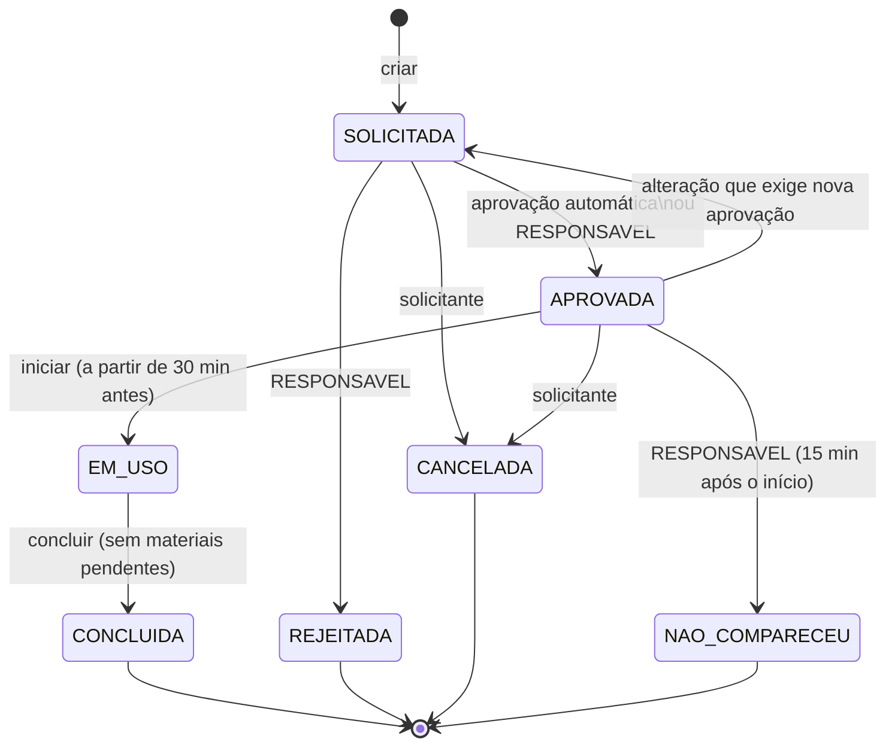

# 1. Requisitos

> 📝 **Rascunho para revisão.** Os IDs abaixo são usados nos nomes dos testes e na matriz de rastreabilidade.
> Ao alterar um requisito, mantenha o ID.

## 1.1 Perfis de acesso

| Perfil do enunciado | Perfil no sistema | O que pode fazer |
|---|---|---|
| Solicitante | `PROFESSOR` | Consulta disponibilidade; cria, altera, cancela e apaga **as próprias** reservas, somente na própria agenda docente. |
| Solicitante | `COORDENADOR` | Igual ao professor, mas pode reservar para **qualquer** docente; acessa relatórios. |
| Responsável | `RESPONSAVEL` | Aprova/rejeita reservas pendentes (recursos restritos e validação docente), registra retirada/devolução de materiais e não comparecimento; consulta auditoria e relatórios. |
| Administrador | `ADMIN` | Gerencia salas, professores, materiais, usuários, bloqueios e períodos de manutenção; consulta auditoria e relatórios. |

## 1.2 Requisitos funcionais

| ID | Requisito | Onde está implementado |
|---|---|---|
| RF01 | Autenticação e autorização por perfil | `auth/*`, `config/SecurityConfig`, `@PreAuthorize` nos controllers |
| RF02 | Cadastro e consulta de salas, professores e materiais | `sala/*`, `professor/*`, `material/*` |
| RF03 | Pesquisa por tipo, capacidade, localização, competência e disponibilidade | `SalaService.pesquisar`, `ProfessorService.pesquisar`, `MaterialService.pesquisar` |
| RF04 | Criação, alteração e cancelamento de reservas | `ReservaService.criar/alterar/cancelar/excluir` |
| RF05 | Detecção de sobreposição de horários, inclusive na agenda do professor | `DisponibilidadeService`, `Intervalo.sobrepoe`, `CalculadoraOcupacao` |
| RF06 | Proteção contra dupla reserva em solicitações simultâneas | `ProtecaoConcorrencia`, `ReservaService.tocarAgenda` |
| RF07 | Aprovação obrigatória para recursos restritos | `AvaliadorAprovacao`, `ReservaService.aprovar/rejeitar` |
| RF08 | Bloqueio de recursos em manutenção | `bloqueio/*`, `DisponibilidadeService.garantirSemBloqueio` |
| RF09 | Registro de retirada e devolução de materiais e equipamentos | `ReservaService.registrarRetirada/registrarDevolucao` |
| RF10 | Histórico auditável de mudanças | `auditoria/*` |
| RF11 | Notificação simulada / integração com API externa | `notificacao/*` (HTTP + WireMock) |
| RF12 | Relatório de utilização por recurso, carga horária alocada e conflitos evitados | `relatorio/*` |
| RF13 | Interface responsiva e mensagens de erro compreensíveis | `frontend/` (Angular), `FrontendConfig`, `ApiExceptionHandler` |
| RF14 | Documentação de API ou dos fluxos públicos | Swagger UI em `/swagger-ui.html` (springdoc), `docs/` |

## 1.3 Regras de negócio

| ID | Regra | Onde está implementada |
|---|---|---|
| RN01 | O término deve ser posterior ao início | `Intervalo` (construtor) |
| RN02 | Reservas do mesmo recurso não podem se sobrepor — sala, material ou professor | `DisponibilidadeService` |
| RN03 | Duas solicitações simultâneas devem produzir uma única reserva aceita | `ProtecaoConcorrencia` |
| RN04 | Recursos em manutenção não podem ser reservados | `DisponibilidadeService.garantirSemBloqueio` |
| RN05 | Ciclo de estados SOLICITADA → APROVADA → EM_USO → CONCLUIDA; alternativos REJEITADA, CANCELADA, NAO_COMPARECEU | `StatusReserva` |
| RN06 | Somente responsáveis aprovam recursos restritos | `SecurityConfig` + `@PreAuthorize("hasRole('RESPONSAVEL')")` |
| RN07 | Reservas iniciadas não podem ser apagadas | `ReservaService.excluir`, `StatusReserva.iniciada` |
| RN08 | Toda mudança de estado deve gerar auditoria | `ReservaService.mudarStatus` (único ponto de transição) |
| RN09 | Quantidade de alunos não pode exceder a capacidade da sala | `ReservaService.carregarEValidar` |
| RN10 | Reservas no futuro, no mesmo dia, entre 07:00 e 23:00, com duração entre 30 min e 6 h | `PoliticaHorario` |

## 1.4 Requisitos não funcionais

| ID | Requisito | Critério de aceite / evidência |
|---|---|---|
| RNF01 | Desempenho sob carga | JMeter: 20 usuários simultâneos, erro < 1%, cada requisição ≤ 1000 ms, meta p95 ≤ 500 ms |
| RNF02 | Autorização e proteção de acesso | Testes de 401/403 por perfil, token adulterado, força bruta (429), cabeçalhos de segurança |
| RNF03 | Validação de entrada | Bean Validation com mensagens em português; testes de JSON malformado, injeção de SQL e curingas do LIKE, atribuição em massa |
| RNF04 | Tratamento seguro de erros | Problem Details (RFC 9457) com `codigo` e `correlationId`; nenhum stack trace exposto |
| RNF05 | Cobertura de testes | JaCoCo: ≥ 80% de linhas e ≥ 70% de ramificações (o build falha abaixo disso) |
| RNF06 | Qualidade estática | SonarCloud com Quality Gate aprovado em cada pull request |
| RNF07 | Integridade dos dados no banco relacional | MySQL com chaves estrangeiras, chaves únicas e CHECK; esquema versionado (Flyway) e validado pelo Hibernate na inicialização |

## 1.5 Ciclo de vida da reserva

**Quando a reserva precisa de aprovação?** Quando envolve sala restrita, material restrito ou quando o
professor não tem a competência da disciplina cadastrada (validação da alocação docente). Caso contrário,
o próprio sistema aprova automaticamente — e essa transição também é auditada, com o autor `SISTEMA`.
