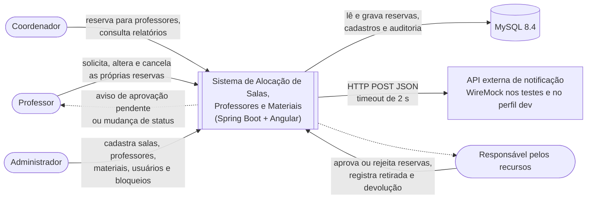
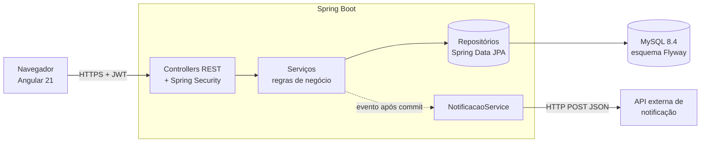
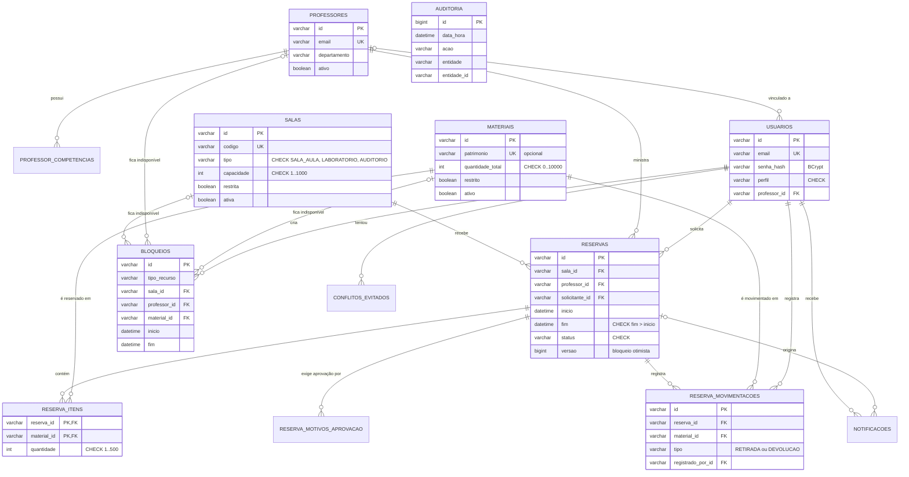
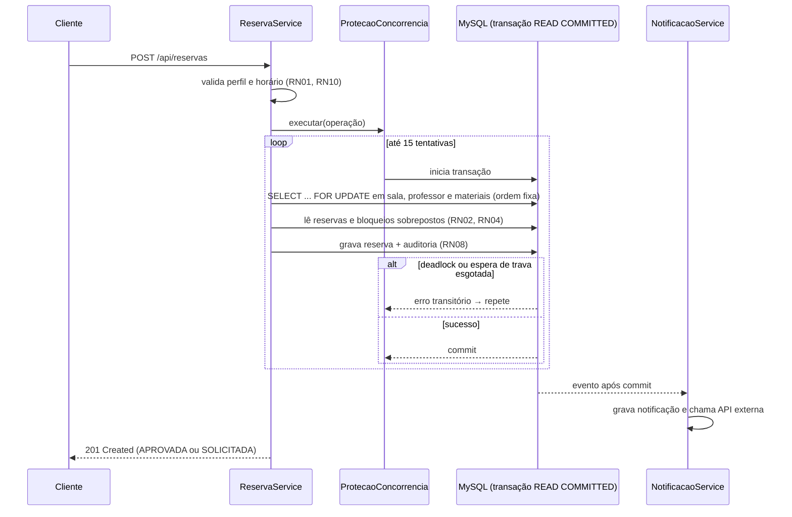
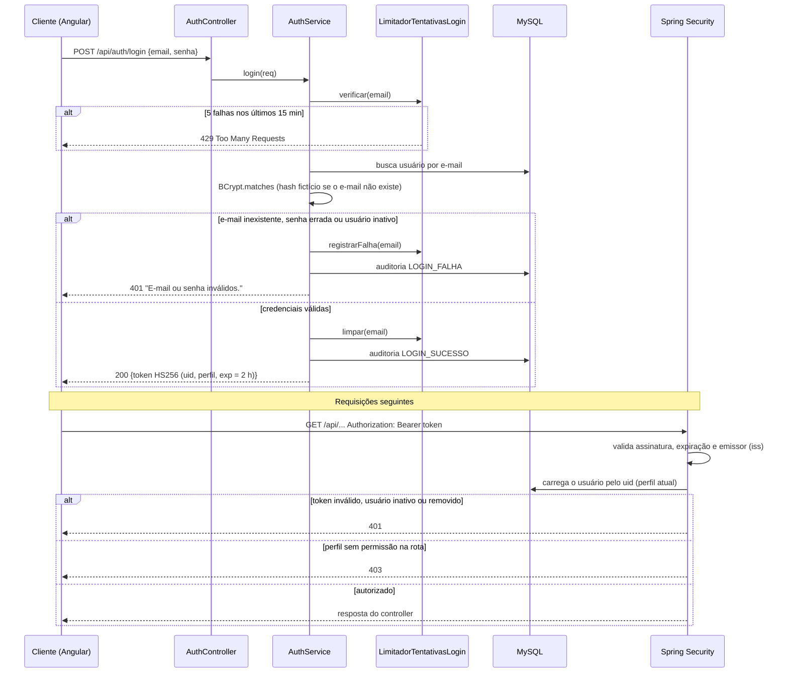
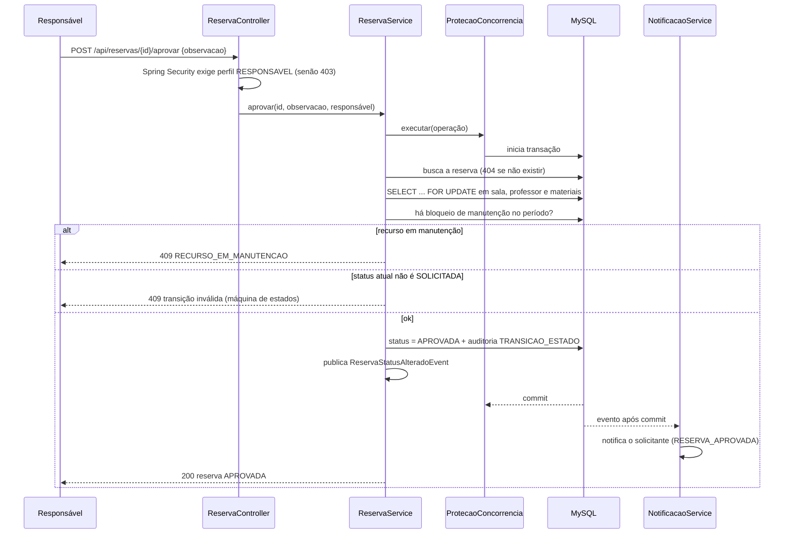
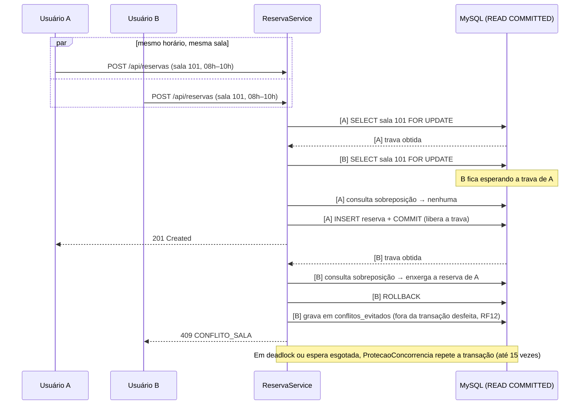
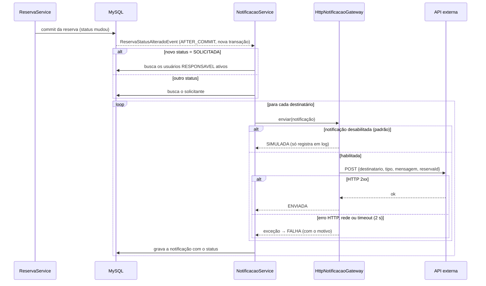

# 2. Arquitetura

## 2.0 Diagrama de contexto

Mostra o sistema como uma caixa só, com quem o usa e com que ele se comunica.

| Elemento | Tipo | Interação |
|---|---|---|
| Professor, Coordenador, Responsável, Administrador | Atores humanos (perfis do RF01) | Usam a interface Angular ou a API REST com token JWT |
| MySQL 8.4 | Sistema externo (banco) | Única fonte de dados; esquema criado pelo Flyway |
| API de notificação | Sistema externo (HTTP) | Recebe as notificações (RF11). Se falhar ou demorar, a reserva continua válida e a falha fica registrada |

## 2.1 Visão geral

Aplicação única **Java 21 + Spring Boot 4**, que expõe uma API REST e serve a interface web em **Angular 21**. O Maven compila o Angular
(`frontend/`) durante o build e copia o resultado para `static/` dentro do `.jar`, então API e
interface são entregues juntas, na mesma porta.
Persistência em **MySQL 8.4** (banco relacional), acessado com **Spring Data JPA / Hibernate 7**. O
esquema é versionado com **Flyway** (`src/main/resources/db/migration`) e o Hibernate só valida o
mapeamento (`ddl-auto=validate`), nunca altera tabelas sozinho.

## 2.2 Organização do código (pacote por funcionalidade)

| Pacote | Responsabilidade |
|---|---|
| `web` | Encaminha as rotas do Angular (`/reservas`, `/login`...) para o `index.html`, permitindo recarregar a página em qualquer tela |
| `config` | Segurança (JWT, perfis, cabeçalhos), OpenAPI, relógio, correlationId, dados de demonstração |
| `comum` | Tratamento centralizado de erros (`ApiExceptionHandler`), códigos de erro, utilitários de filtro |
| `auth`, `usuario` | Login, emissão do token, limite de tentativas, gestão de usuários |
| `sala`, `professor`, `material` | Cadastros e pesquisas |
| `bloqueio` | Períodos de manutenção / indisponibilidade |
| `reserva` | Núcleo: `ReservaService`, máquina de estados, disponibilidade, concorrência |
| `reserva.regras` | Regras puras, sem banco (facilmente testáveis): `Intervalo`, `PoliticaHorario`, `CalculadoraOcupacao`, `AvaliadorAprovacao` |
| `auditoria` | Histórico imutável de mudanças |
| `notificacao` | Notificações e integração HTTP com a API externa |
| `relatorio` | Utilização, carga horária e conflitos evitados |

**Decisão:** as regras de negócio mais críticas foram isoladas em classes puras (`reserva.regras`), sem
dependência de Spring ou banco. Isso permite testá-las com centenas de combinações em milissegundos
(testes parametrizados) e deixa os testes de integração focados na interação com o banco.

## 2.3 Modelo de dados (relacional)

O esquema completo está em `src/main/resources/db/migration/V1__esquema_inicial.sql`. As tabelas
seguem a 3ª forma normal: a reserva guarda só as chaves de sala, professor e solicitante, e os nomes
são obtidos por junção (não há cópias que possam ficar desatualizadas).

| Tabela | Conteúdo | Restrições e índices relevantes |
|---|---|---|
| `usuarios` | nome, e-mail, hash BCrypt, perfil, vínculo com professor | e-mail único; FK `professor_id`; CHECK do perfil |
| `salas` | código, tipo, capacidade, localização, restrita, ativa | código único; CHECK de tipo e capacidade |
| `professores` / `professor_competencias` | dados do docente; uma linha por competência | e-mail único; PK (professor, competência) |
| `materiais` | nome, categoria, patrimônio, quantidade total, restrito | patrimônio único (vários nulos permitidos) |
| `reservas` | sala, professor, solicitante, período, status, `versao` | FKs; CHECK `fim > inicio`; índices (sala_id, status, inicio) e (professor_id, status, inicio) |
| `reserva_itens` | materiais e quantidades da reserva | PK (reserva, material); FK com `ON DELETE CASCADE` |
| `reserva_motivos_aprovacao` | motivos que exigem aprovação, em ordem | PK (reserva, ordem) |
| `reserva_movimentacoes` | retiradas e devoluções | FKs para reserva, material e usuário |
| `bloqueios` | recurso, período e motivo | uma FK por tipo de recurso + CHECK que exige só a coluna do tipo informado |
| `auditoria` | data/hora, autor, ação, entidade, estado anterior/novo, correlationId | `BIGINT AUTO_INCREMENT` (ordem estável); **sem FK de propósito**, para o histórico sobreviver ao registro |
| `notificacoes` | destinatário, mensagem, status (SIMULADA/ENVIADA/FALHA) | FK do destinatário; FK da reserva com `ON DELETE SET NULL` |
| `conflitos_evitados` | tipo de conflito, recurso, período, solicitante | índice em `registrado_em` |

**Identificadores.** As entidades usam UUID versão 7 em texto (`VARCHAR(36)`). Ele é gerado pela
aplicação, não expõe a quantidade de registros (como faria um número sequencial) e é ordenável por
data de criação. Assim, o contrato da API, os testes Postman e o front-end continuaram os mesmos.

**Datas.** `DATETIME(6)` sem fuso, como `LocalDateTime` no Java: os horários de aula são sempre locais.

## 2.4 Fluxo de criação de reserva

## 2.4.1 Login e uso do token JWT (RF01, RNF02)

O perfil vem do banco a cada requisição, e não do token. Assim, desativar um usuário ou mudar o perfil
vale na hora (defeito [DEF-002](defeitos/DEF-002.md)).

## 2.4.2 Aprovação de reserva com recurso restrito (RF07, RN04, RN05)

A revalidação da manutenção na aprovação corrige o defeito [DEF-003](defeitos/DEF-003.md).

## 2.4.3 Dupla reserva em solicitações simultâneas (RF06, RN03)

Evidência: `ConcorrenciaReservaIT` (20 pedidos simultâneos → 1 aceito; 10 requisições HTTP → um 201 e
nove 409; estoque de 3 projetores → exatamente 3 aceitos).

## 2.4.4 Notificação para a API externa (RF11)

A notificação roda **depois** do commit e numa transação própria: uma falha externa nunca desfaz a
reserva. Evidência: `NotificacaoWireMockIT` (contrato JSON, erro 500 e resposta acima do timeout).

## 2.5 Proteção contra dupla reserva (RF06 / RN03)

O MySQL não tem restrição de exclusão de intervalos (como o `EXCLUDE` do PostgreSQL). A proteção usa
**travas pessimistas de linha** do InnoDB:

1. A transação executa `SELECT ... FOR UPDATE` nas linhas da sala, do professor e dos materiais
   envolvidos, **sempre na mesma ordem** (sala → professor → materiais por id), o que evita deadlocks.
2. Uma segunda transação que queira o mesmo recurso **espera** a primeira terminar.
3. Com isolamento **READ COMMITTED**, quando ela continua, a consulta de sobreposição já enxerga a
   reserva confirmada pela primeira e a solicitação é recusada com `409`.
4. Se mesmo assim ocorrer deadlock ou o tempo de espera esgotar, o `ProtecaoConcorrencia` repete a
   transação (até 15 vezes, com espera aleatória).

O mesmo mecanismo protege a aprovação de reservas e a criação de bloqueios de manutenção.

Evidência: `ConcorrenciaReservaIT` dispara 20 solicitações simultâneas e verifica que **exatamente uma**
é aceita (também para o mesmo professor e para o estoque de materiais).

Alterações simultâneas da mesma reserva são protegidas por **bloqueio otimista** (`@Version`).

## 2.6 Decisões e alternativas consideradas

| Decisão | Alternativa | Motivo da escolha |
|---|---|---|
| MySQL relacional com FKs e CHECK | MongoDB (versão anterior do projeto) | Pedido do professor; a integridade passa a ser garantida pelo banco, mesmo fora da API |
| `SELECT ... FOR UPDATE` em ordem fixa | Trava distribuída (Redis), fila única, coluna de versão | Sem infraestrutura extra; garantia dada pelo próprio banco |
| Flyway + `ddl-auto=validate` | `ddl-auto=update` | Esquema revisável e versionado no Git; nada muda no banco sem migração |
| JWT stateless | Sessão com cookie | API consumida por front-end e ferramentas (JMeter); dispensa CSRF |
| Notificação após o commit | Notificar dentro da transação | Nunca notificar algo que foi desfeito; falha externa não desfaz a reserva |
| Relógio injetado (`Clock`) | `LocalDateTime.now()` direto | Regras de tempo testáveis de forma determinística |
| Angular compilado pelo Maven e servido pelo Spring | Servir o Angular à parte (`ng serve` em :4200) | Uma única aplicação para rodar; não depende do Node instalado na máquina; mesma origem, então não precisa de CORS |
