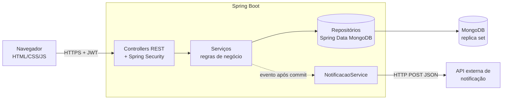
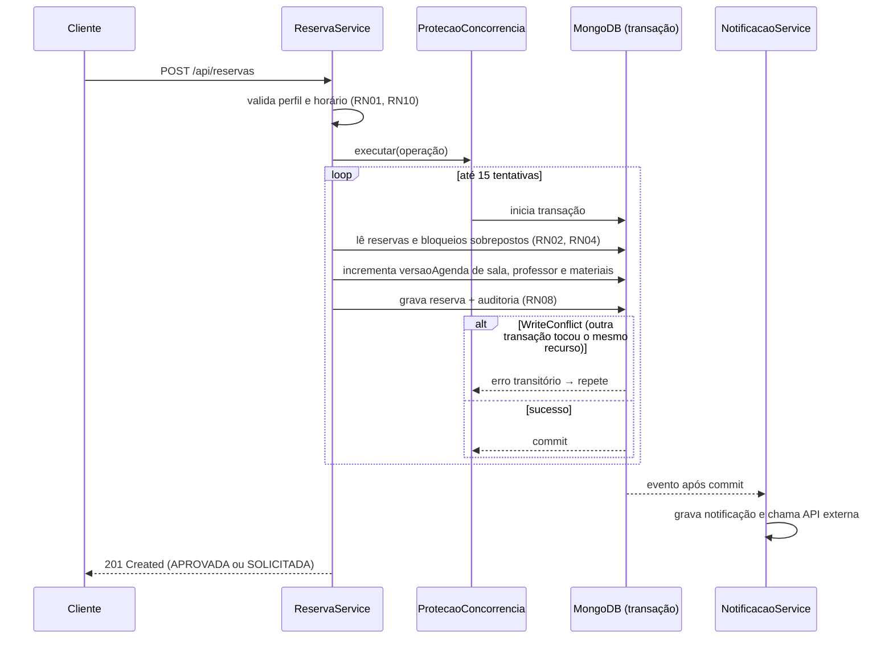

# 2. Arquitetura

> 📝 **Rascunho para revisão.**

## 2.1 Visão geral

Aplicação única **Java 21 + Spring Boot 4**, que expõe uma API REST e serve a interface web estática.
Persistência em **MongoDB 9** (replica set, necessário para transações multi-documento).

## 2.2 Organização do código (pacote por funcionalidade)

| Pacote | Responsabilidade |
|---|---|
| `config` | Segurança (JWT, perfis, cabeçalhos), transações MongoDB, OpenAPI, relógio, correlationId, dados de demonstração |
| `comum` | Tratamento centralizado de erros (`ApiExceptionHandler`), códigos de erro, utilitários de filtro |
| `auth`, `usuario` | Login, emissão do token, limite de tentativas, gestão de usuários |
| `sala`, `professor`, `material` | Cadastros e pesquisas |
| `bloqueio` | Períodos de manutenção / indisponibilidade |
| `reserva` | Núcleo: `ReservaService`, máquina de estados, disponibilidade, concorrência |
| `reserva.regras` | Regras puras, sem banco (facilmente testáveis): `Intervalo`, `PoliticaHorario`, `CalculadoraOcupacao`, `AvaliadorAprovacao` |
| `auditoria` | Histórico imutável de mudanças |
| `notificacao` | Notificações e integração HTTP com a API externa |
| `relatorio` | Utilização, carga horária e conflitos evitados |

**Decisão:** as regras de negócio mais críticas foram isoladas em classes puras (`reserva.regras`), sem
dependência de Spring ou banco. Isso permite testá-las com centenas de combinações em milissegundos
(testes parametrizados) e deixa os testes de integração focados na interação com o banco.

## 2.3 Modelo de dados (coleções MongoDB)

| Coleção | Conteúdo | Índices relevantes |
|---|---|---|
| `usuarios` | nome, e-mail, hash BCrypt, perfil, vínculo com professor | e-mail único |
| `salas` | código, tipo, capacidade, localização, restrita, ativa, `versaoAgenda` | código único, tipo |
| `professores` | nome, e-mail, departamento, competências, `versaoAgenda` | e-mail único, competências |
| `materiais` | nome, categoria, patrimônio, quantidade total, restrito, `versaoAgenda` | patrimônio único (esparso) |
| `reservas` | sala, professor, solicitante, período, status, **itens e movimentações embutidos**, `versao` | (salaId, status, inicio), (professorId, status, inicio), (itens.materialId, status, inicio) |
| `bloqueios` | tipo e id do recurso, período, motivo | (tipoRecurso, recursoId, inicio) |
| `auditoria` | data/hora, autor, ação, entidade, estado anterior/novo, detalhes, correlationId | (entidade, entidadeId, dataHora) |
| `notificacoes` | destinatário, mensagem, status (SIMULADA/ENVIADA/FALHA) | destinatarioId |
| `conflitos_evitados` | tipo de conflito, recurso, período, solicitante | registradoEm |

Materiais e movimentações ficam **embutidos** no documento da reserva porque sempre são lidos e
gravados junto com ela (modelo natural de documentos).

## 2.4 Fluxo de criação de reserva

## 2.5 Proteção contra dupla reserva (RF06 / RN03)

O MongoDB não tem restrições de exclusão de intervalos. A proteção usa o isolamento por *snapshot*
das transações:

1. A transação verifica que não há conflito.
2. Em seguida, **"toca"** o documento de cada recurso envolvido (`$inc versaoAgenda`).
3. Se duas transações verificaram ao mesmo tempo, as duas tentam escrever no mesmo documento.
   O MongoDB aborta uma delas com `WriteConflict`.
4. A abortada é repetida. Na nova tentativa, ela enxerga a reserva confirmada e é recusada com `409`.

Evidência: `ConcorrenciaReservaIT` dispara 20 solicitações simultâneas e verifica que **exatamente uma**
é aceita (também para o mesmo professor e para o estoque de materiais).

Alterações simultâneas da mesma reserva são protegidas por **bloqueio otimista** (`@Version`).

## 2.6 Decisões e alternativas consideradas

| Decisão | Alternativa | Motivo da escolha |
|---|---|---|
| Transação + "toque" no recurso | Trava distribuída (Redis), fila única | Sem infraestrutura extra; garantia dada pelo próprio banco |
| JWT stateless | Sessão com cookie | API consumida por front-end e ferramentas (JMeter); dispensa CSRF |
| Notificação após o commit | Notificar dentro da transação | Nunca notificar algo que foi desfeito; falha externa não desfaz a reserva |
| Relógio injetado (`Clock`) | `LocalDateTime.now()` direto | Regras de tempo testáveis de forma determinística |
| Front-end sem framework | React/Angular | Escopo da disciplina é qualidade; menos dependências |
