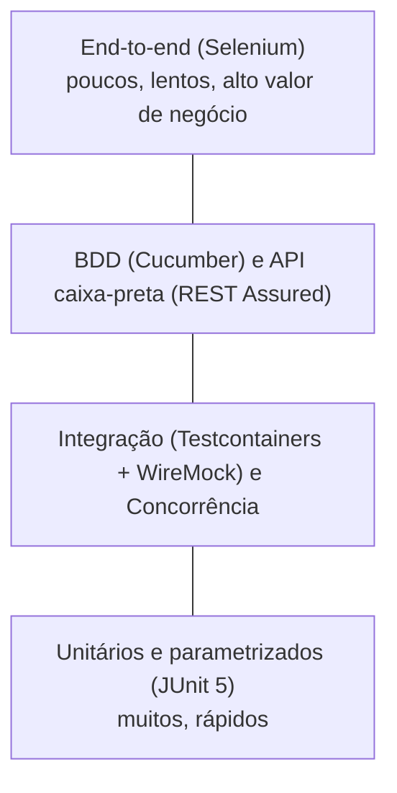

# 3. Plano de testes

## 3.1 Objetivo

Produzir **evidências objetivas** de que o sistema atende aos requisitos funcionais, às regras críticas
(tempo, concorrência, estados, auditoria) e aos requisitos não funcionais (segurança e desempenho).

## 3.2 Estratégia (pirâmide de testes)

| Nível | Ferramentas | Classes | O que garante | Precisa de Docker? |
|---|---|---|---|---|
| Unitário / parametrizado | JUnit 5, AssertJ, Mockito | `*Test` | Regras puras: sobreposição, horários, máquina de estados, pico de materiais, aprovação | Não |
| Integração | Spring Boot Test, **Testcontainers (MySQL 8.4)** | `integracao/*IT`, `banco/*IT` | Regras com banco real: conflitos, manutenção, auditoria na mesma transação, FKs e CHECK | Sim |
| Integração externa | **WireMock** | `NotificacaoWireMockIT` | Contrato JSON, falha 500 e timeout da API de notificação | Sim |
| Concorrência | `ExecutorService` + `CountDownLatch` | `ConcorrenciaReservaIT` | 20 solicitações simultâneas → uma aceita | Sim |
| API caixa-preta | **REST Assured** | `api/*IT` | Contrato HTTP, códigos de status, autorização, validação, erros seguros | Sim |
| BDD | **Cucumber** (Gherkin em português) | `bdd/*`, `features/*.feature` | Critérios de aceite da retirada/devolução de materiais | Sim |
| End-to-end | **Selenium** (Chrome headless) | `e2e/*IT` | Fluxo real pela interface, mensagens e responsividade | Sim + Chrome |
| Desempenho | **JMeter** | `src/test/jmeter/*.jmx` | Tempo de resposta e taxa de erro sob carga | App rodando |
| Estática | **SonarCloud**, **JaCoCo** | CI | Bugs, *code smells*, vulnerabilidades, cobertura | — |

## 3.3 Técnicas de projeto de casos de teste

- **Partição de equivalência e valor-limite:** horários na abertura (07:00) e no fechamento (23:00),
  duração mínima (30 min) e máxima (6 h), capacidade exata da sala, estoque exato do material.
- **Tabela de decisão / transição de estados:** as 49 combinações `estado × estado` da reserva são testadas
  (`StatusReservaTest.matrizDeTransicoes`).
- **Casos de sobreposição:** parcial, contido, idêntico, adjacente (fim = início) e separado (`IntervaloTest`).
- **Testes negativos de segurança:** sem token, token adulterado ou forjado, perfil errado, JSON malformado,
  injeção de SQL e curingas do LIKE, atribuição em massa.

## 3.4 Ambiente

- Testes de integração sobem um **MySQL 8.4 real em container** (Testcontainers), com o esquema criado pelas
  mesmas migrações Flyway da produção. Sem Docker, usam um MySQL local informado em `MYSQL_URL_TESTE`.
  Cada teste começa com as tabelas vazias.
- A API externa de notificação é simulada pelo **WireMock** em porta aleatória.
- Um **relógio controlável** (`RelogioTeste`) fixa "agora" em 11/03/2030 08:00. Isso torna determinísticos os
  testes de "iniciar uso", "não comparecimento" e "reserva no passado".
- O banco é limpo antes de cada teste, garantindo independência entre os testes.

## 3.5 Como executar

| Comando | O que roda |
|---|---|
| `./mvnw test` | Apenas unitários (sem Docker) |
| `./mvnw verify` | Tudo: unitários, integração, API, concorrência, BDD, E2E + cobertura |
| `./mvnw verify -Psem-e2e` | Tudo, exceto o navegador (Selenium) |
| `./mvnw verify -Pdesempenho` | Plano JMeter (com a aplicação rodando em `localhost:8080`) |
| `python3 scripts/rastreabilidade.py` | Regenera a matriz de rastreabilidade |

Relatórios gerados:

- `target/site/jacoco/index.html`: cobertura
- `target/surefire-reports/` e `target/failsafe-reports/`: resultados JUnit
- `target/cucumber/relatorio.html`: cenários BDD
- `target/jmeter/reports/`: dashboard de desempenho

## 3.6 Critérios de entrada e saída

**Entrada:** código compila; ambiente Docker disponível.

**Saída (definição de pronto):**

- 100% dos testes automatizados passando;
- cobertura ≥ 80% de linhas e ≥ 70% de ramos (JaCoCo, o build falha abaixo disso);
- Quality Gate do SonarCloud aprovado;
- JMeter com taxa de erro < 1%;
- todos os requisitos com pelo menos uma verificação na matriz de rastreabilidade.
